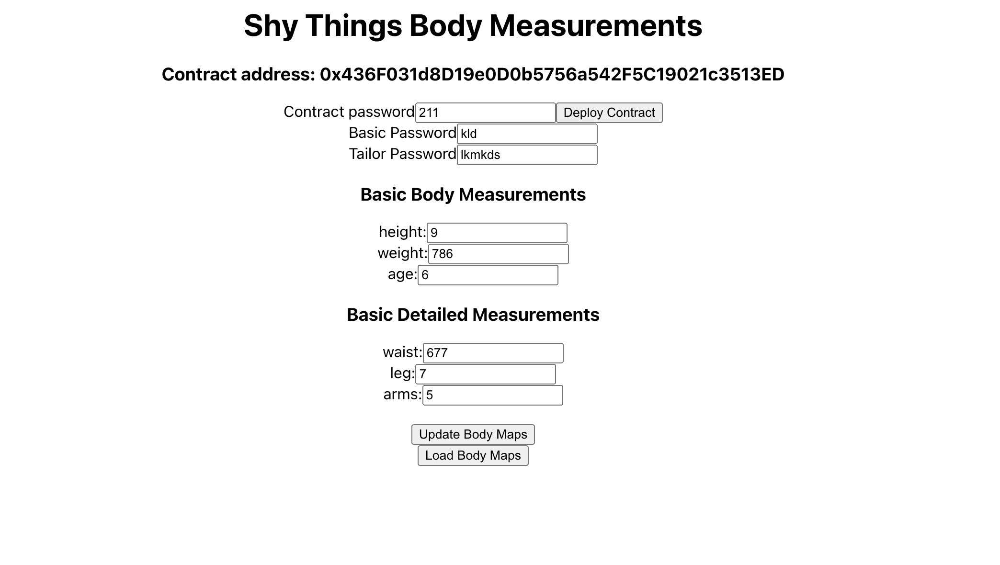

# Shy Things

Shy Things is a local Ethereum application for storing personal body measurements as ciphertext. You deploy your own `Measurements` contract from the browser, encrypt a basic map (height, weight, age) and a tailor map (waist, leg, arms) under separate passwords, and write those ciphertexts on-chain. A master contract password has to match before the stored values can be replaced. It is meant to be run on your own machine, with a browser wallet that injects `window.ethereum`.



## Features

- Deploy `Measurements` from the UI. The constructor stores `keccak256` of the master password and records `msg.sender` as `owner`.
- Replace both measurement strings in one call. `setMeasurements` writes the new values when the supplied master password hashes to the stored hash, and leaves storage unchanged when the hash does not match. The call does not revert on a mismatch.
- Keep two maps, each with its own client password: basic (`height`, `weight`, `age`) and detailed (`waist`, `leg`, `arms`).
- AES-encrypt each map in the browser with CryptoJS before the transaction, and decrypt it locally on load.
- Compile the Solidity source with `solc` in Node and serve the ABI and bytecode from `GET /`, so the client deploys the artifact that compilation just produced.
- Test deployment and both password outcomes on an in-process Ganache chain.

## Tech stack

- **Contract:** Solidity `^0.8.19`, compiled with the `solc` package `0.8.19` using the standard JSON input.
- **Chain access:** `web3` `1.8.2` in the UI and in the tests. Tests use `ganache-cli` `6.12.2`. The UI uses the injected `window.ethereum` provider.
- **API:** Express `4.18` on port `4000`. CORS allows only `http://localhost:3000`. `server.js` imports `cors`, which the lockfile installs transitively; it is not listed in `backend/package.json`.
- **Contract tests:** Mocha `10.4` and Node `assert`.
- **UI:** React `18.3` via Create React App (`react-scripts` `4.0.3`). The `start`, `test`, and `build` scripts pass `--openssl-legacy-provider`.
- **Client encryption:** `crypto-js` `4.1` AES. Encryption runs in the browser. The contract stores the strings it is given.

## Architecture

Two independent npm projects. There is no root workspace.

```
backend/
  contracts/measurements.sol    Measurements contract
  compile.js                    solc JSON compile; exports the Measurements artifact
  server.js                     serves that artifact on port 4000
  test/measurements.test.js     Ganache deploy and password tests
frontend/
  src/App.js                    accounts, deploy, encrypt, update, decrypt
  public/                       Create React App shell
```

`compile.js` is the only compilation path. The Express server and the Mocha suite both load it, so the UI deploys the same ABI and bytecode the tests use.

1. On load, the UI calls `eth_requestAccounts` on `window.ethereum` and builds a Web3 instance from that provider.
2. **Deploy Contract** reads `http://localhost:4000` and deploys `Measurements` with the master password as the constructor argument (`gas: 1000000`).
3. **Update Body Maps** JSON-encodes each measurement object, AES-encrypts it with that map's password, and sends `setMeasurements(masterPassword, basicCiphertext, tailorCiphertext)` from the connected account (`gas: 5000000`).
4. **Load Body Maps** reads the public `basicMeasurements` and `detailedMeasurements` strings and AES-decrypts them with the same two passwords.

`setMeasurements` hashes the cleartext password with `keccak256(abi.encodePacked(...))` and assigns both strings only on a match. `owner` is stored in the constructor and is not consulted by that function, so any account that knows the master password can submit the update. The measurement strings are public state. Confidentiality is the pair of AES passwords held in the browser.

`compile.js` opens `contracts/Measurements.sol`. The file in the tree is `contracts/measurements.sol`. On a case-sensitive filesystem the compiler, `node server.js`, and `npm test` cannot read the source until those two names agree.

## Getting started

**Prerequisites**

- Node.js and npm. The installed `solc` `0.8.19` declares `node >= 10`. The frontend scripts pass `--openssl-legacy-provider`, which applies when Node is built with OpenSSL 3.
- A browser wallet that injects `window.ethereum`. Account access runs at page load, and transactions are sent from `accounts[0]`.
- No application environment variables. Ports and the allowed browser origin are hard-coded: API on port `4000`, UI at `http://localhost:3000`.

**API**

```sh
cd backend
npm install
node server.js
```

The process logs `Server is running on port 4000`. `GET /` returns the `solc` output for `Measurements` (including `abi` and `evm.bytecode`).

**UI**

```sh
cd frontend
npm install
npm start
```

Create React App serves the UI at [http://localhost:3000](http://localhost:3000). Start the API before deploying; the page fetches the artifact from the API origin above.

**Test and build**

```sh
cd backend
npm test
```

```sh
cd frontend
npm test
```

```sh
cd frontend
npm run build
```

| Command | What it runs |
| --- | --- |
| `backend`: `npm test` | Mocha. The default lookup loads `test/measurements.test.js`. |
| `frontend`: `npm test` | `react-scripts test` (Jest). |
| `frontend`: `npm run build` | Production bundle written to `frontend/build`. |

The backend suite deploys `Measurements` on Ganache with the password `password`, writes new basic and tailor strings when that password is supplied, and checks that a wrong password leaves both strings unchanged.

`frontend/src/App.test.js` is the Create React App sample. It looks for the text `learn react`, which this UI does not render. `npm run eject` is still the unused Create React App eject script.

## Project status

Prototype. The tree holds the contract, the compiler and local API, Ganache tests, and the React client. There is no deployment configuration in the repository.

The contract comment describes deleting measurements. The contract has no delete function. Items carried forward from the previous project notes, and absent from the code: standardised token templates, monetizing the stored data, and privacy controls for receiving data requests and blocking entities.

`Measurements.sol` declares `SPDX-License-Identifier: MIT`. `backend/package.json` declares `"license": "ISC"`. The repository has no `LICENSE` file.

## What this demonstrates

The project runs a straight path from a Solidity file to a wallet-backed UI, and it shares one compilation step between the tests and the client.

- A write gate built from a stored `keccak256` password hash, with Ganache tests for a matching password and for a mismatch that leaves storage as it was.
- A `solc` standard-JSON compile in Node, required by both Mocha and a one-route Express server, so the browser deploys the artifact the server compiled.
- A React client on an injected Ethereum provider: account requests, contract deployment, and state-changing calls with explicit gas limits.
- Per-map AES in the browser, so each measurement class has its own password and the chain stores ciphertext the UI can round-trip.
- A small HTTP boundary: one JSON route and a single allowed origin (`http://localhost:3000`).

## Author

Samuel Mensah ([@simiel](https://github.com/simiel)) — [simieldev@gmail.com](mailto:simieldev@gmail.com) · [@smenxa](https://twitter.com/smenxa)
